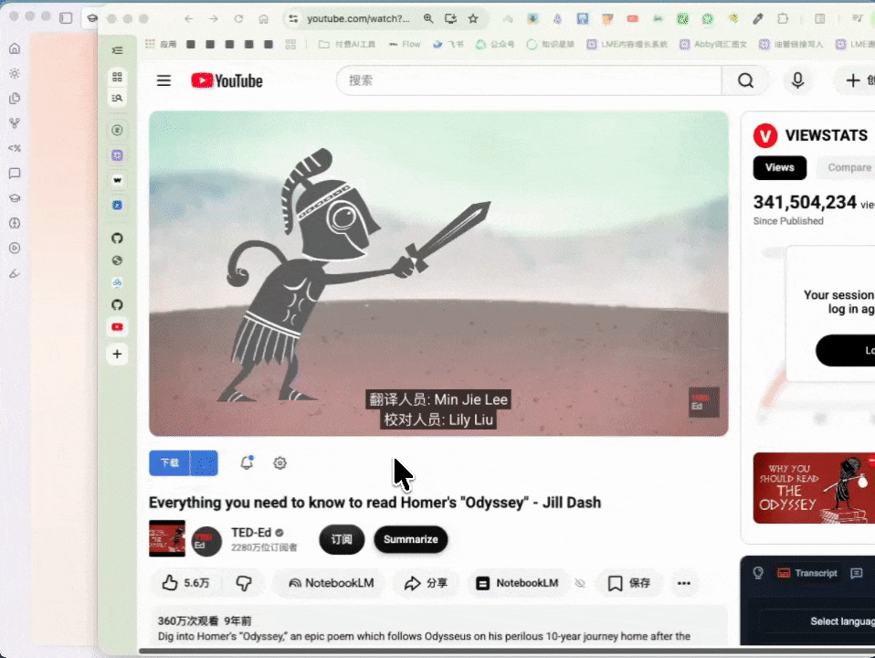
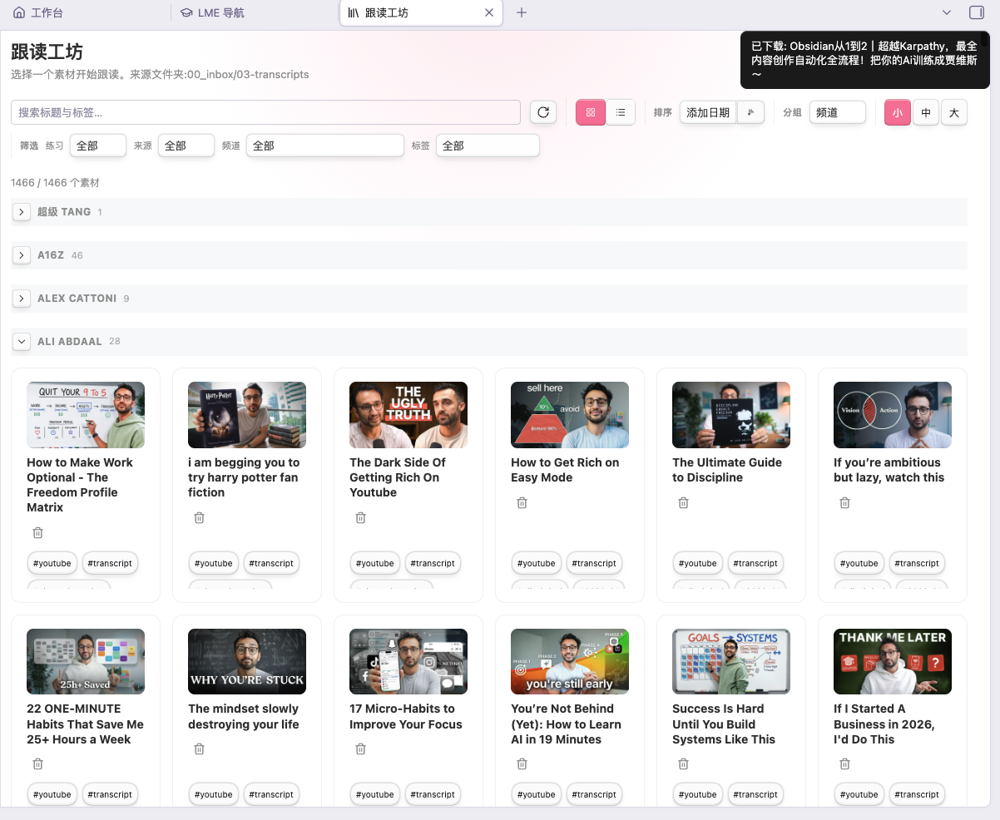
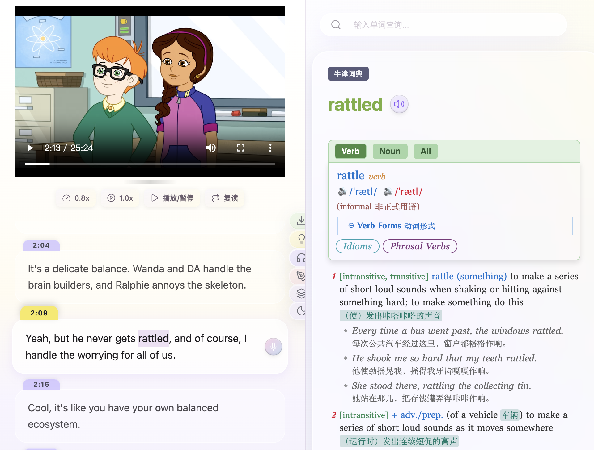
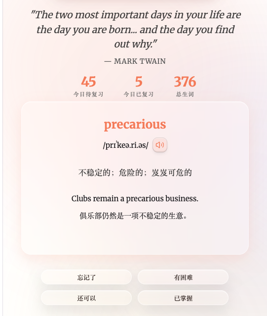
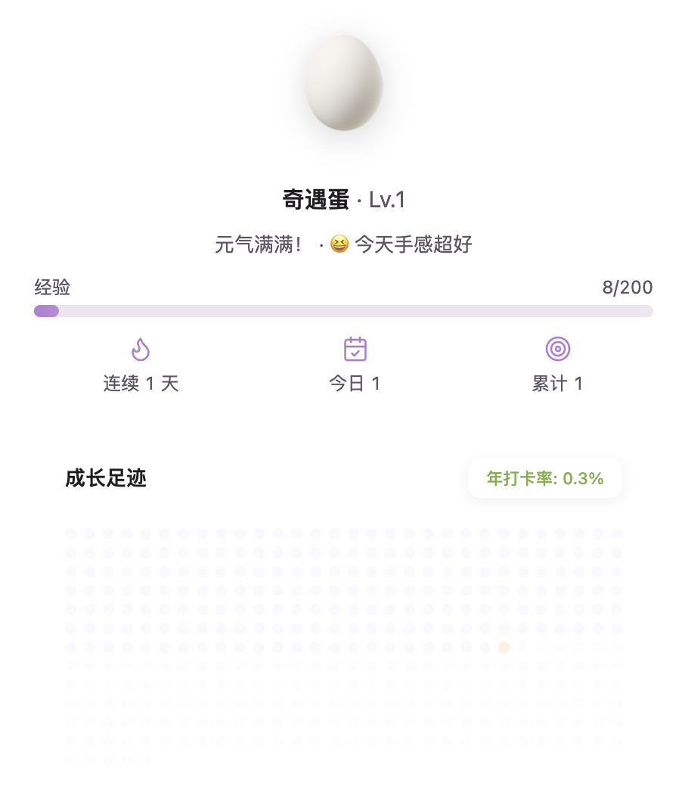
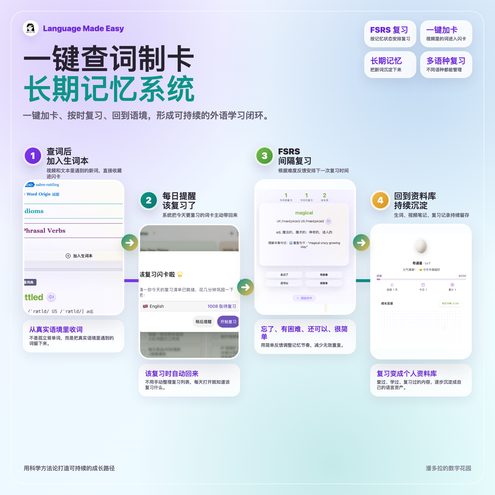
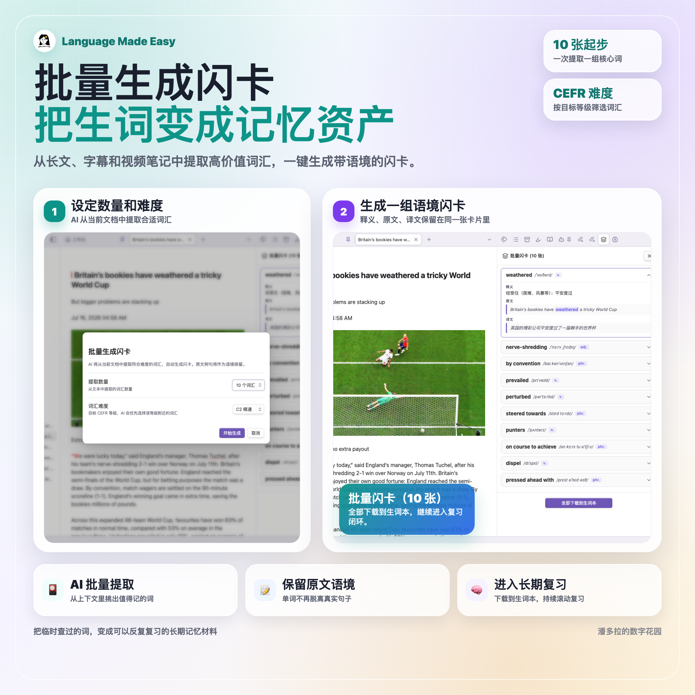
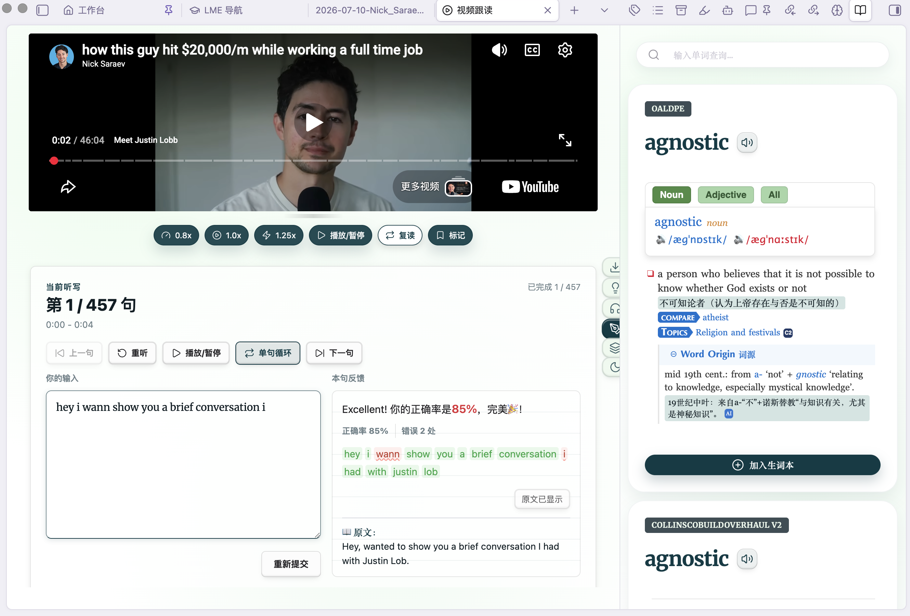
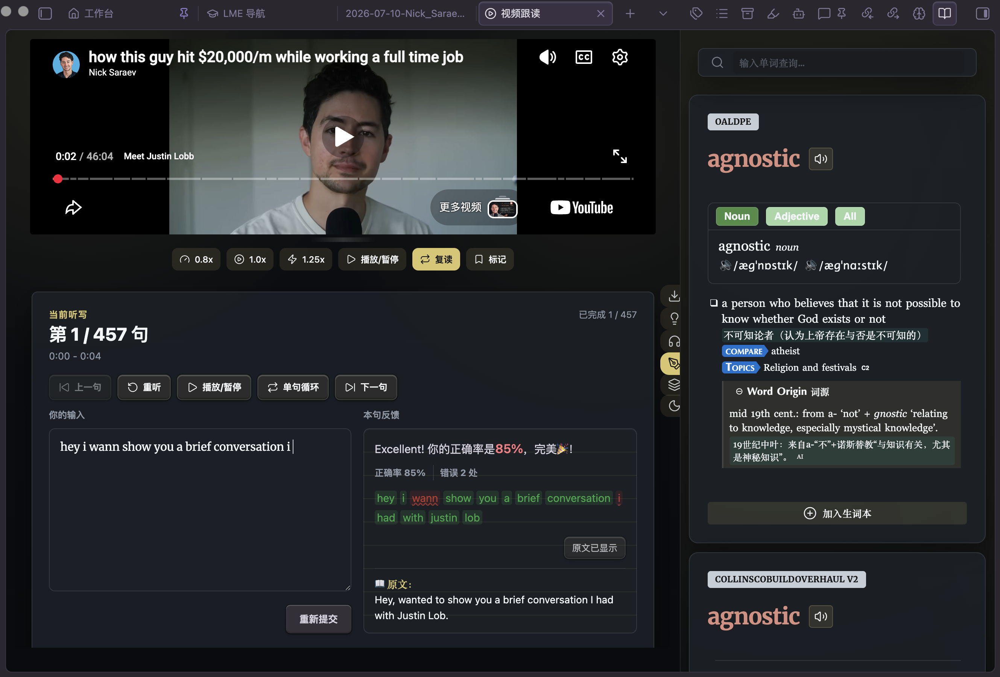
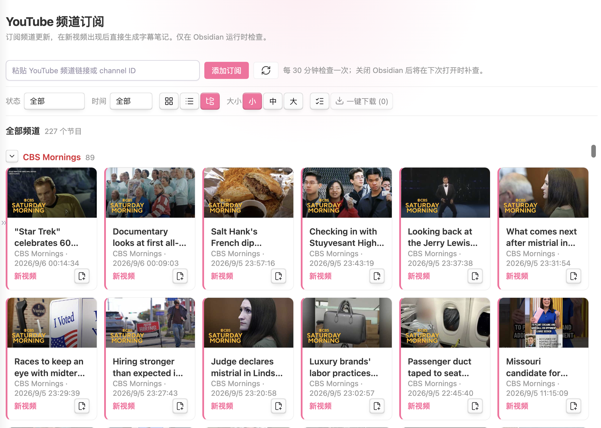

# Language Made Easy — พื้นที่เรียนภาษาอังกฤษแบบดื่มด่ำใน Obsidian

> 🌐 ภาษาอื่น ๆ: [English](./README-EN.md) · [简体中文](./README.md) · [繁體中文](./README-ZH-TW.md) · [Deutsch](./README-DE.md) · [Français](./README-FR.md) · [Español](./README-ES.md) · [日本語](./README-JA.md) · [한국어](./README-KO.md) · [Русский](./README-RU.md) · ไทย

**Language Made Easy (LME)** เปลี่ยน vault ของคุณใน Obsidian ให้กลายเป็นพื้นที่เรียนภาษาอังกฤษแบบดื่มด่ำครบวงจร: ค้นพจนานุกรมได้ทันทีระหว่างอ่าน, การ์ดคำศัพท์แบบทบทวนตามรอบด้วย FSRS, ฝึกออกเสียงตามวิดีโอพร้อมซับไตเติลที่ซิงก์กัน และการวิเคราะห์ด้วย AI — ทั้งหมดอยู่ในที่เดียว และถูกเก็บเป็นโน้ตธรรมดาใน vault ของคุณ

> ### 💡 แจ้งเตือนเรื่องโมเดล Freemium
> ฟีเจอร์พื้นฐานของปลั๊กอินนี้ติดตั้งและใช้งานได้ฟรี ส่วนฟีเจอร์ขั้นสูงจะปลดล็อกครบทั้งหมดด้วยฉบับเต็ม (Full Edition) — จ่ายครั้งเดียว เข้าถึงได้ตลอดชีพ พร้อมอัปเดตทุกรุ่นในอนาคต ลิงก์สั่งซื้อจะแสดงในกล่องโต้ตอบอัปเกรดภายในปลั๊กอิน ดูความแตกต่างได้ที่ [ตารางเปรียบเทียบฟีเจอร์](#-free-basic-vs-full-edition) ด้านล่าง
>
> **ฉบับพื้นฐานครอบคลุมวงจรการเรียนรู้ประจำวันครบทั้งหมด — ค้นคำศัพท์, ทบทวนการ์ดคำศัพท์, ฝึกออกเสียงตาม และโน้ตวิดีโอ ส่วนความสามารถขั้นสูงอย่างภาษาเพิ่มเติม, ซิงก์ข้ามอุปกรณ์ และการประมวลผลเป็นชุด จะอยู่ในฉบับเต็ม (Full Edition)**

---

## ✨ โมดูลฟีเจอร์ทั้งหมด

### 🎬 สร้างโน้ตวิดีโอคลิกเดียว — จากลิงก์สู่โน้ตพร้อมฝึกตามในขั้นตอนเดียว
วางลิงก์ YouTube / Bilibili แล้วปลั๊กอินจะดึงชื่อวิดีโอ ช่อง และภาพปก สร้างโน้ตซับไตเติลแบบมีโครงสร้าง พร้อมดาวน์โหลดซับไตเติล — พร้อมให้คุณฝึกตามได้ทุกเมื่อ มี 3 จุดเข้าใช้งาน:
- **แผงนำทาง**: ปุ่ม "สร้างโน้ตวิดีโอ" ข้างช่องค้นหา
- **โรงฝึกฝึกตาม**: คลิกไอคอนเวิร์กช็อปในริบบิ้นด้านซ้าย แล้ววางลิงก์ในช่องป้อนข้อมูล
- **หน้าการติดตาม YouTube**: สร้างโน้ตให้วิดีโอใดก็ได้ระหว่างเลื่อนดูฟีด **พร้อมดาวน์โหลดแบบเลือกหลายรายการพร้อมกัน** (ฉบับเต็ม)

**การจัดการโน้ตแบบรวมศูนย์**: โน้ตวิดีโอทั้งหมดอยู่ในหน้าแคตตาล็อกของเวิร์กช็อป พร้อมการจัดเรียง กรอง และจัดกลุ่ม คลิกที่การ์ดเพื่อเริ่มฝึกตาม กด Shift+คลิกเพื่อดูตัวอย่างโน้ต

### 📖 ผู้ช่วยพจนานุกรม — อ่านอะไรก็ได้ ค้นได้ทันที
- **ค้นคำทันที**: `Ctrl/Cmd + ดับเบิลคลิก` คำใดก็ได้ (หรือเลือกข้อความ) — คำอธิบายจะปรากฏในแถบด้านข้างทันที
- **จับบริบท**: ประโยคเต็มที่มีคำนั้นอยู่จะถูกบันทึกเป็นประโยคตัวอย่างโดยอัตโนมัติ
- **พจนานุกรม MDX แบบออฟไลน์**: โหลดพจนานุกรม `.mdx`/`.mdd` ในเครื่องบนเดสก์ท็อปได้โดยไม่จำกัดจำนวน (การนำเข้าบนมือถือเป็นฟีเจอร์ฉบับเต็ม)
- **ลูกโซ่แหล่งออนไลน์สำรอง**: Youdao → Google Translate → MyMemory ทั้งหมดเป็น API สาธารณะฟรี ไม่ต้องใช้คีย์
- **การออกเสียง**: เล่นเสียงพร้อมโหลดล่วงหน้าอย่างชาญฉลาด
- **เพิ่มคลิกเดียว** เข้าสมุดคำศัพท์ของคุณ (IndexedDB + ไฟล์ markdown ที่ดูแลรักษาอัตโนมัติ)

### 🧠 การ์ดคำศัพท์ FSRS — จดจำสิ่งที่คุณเรียน
- **ตัวจัดตาราง FSRS** ที่ล้ำสมัยที่สุด (`ts-fsrs`) คำนวณช่วงเวลาทบทวนที่เหมาะสมที่สุดสำหรับทุกการ์ด
- **โหมดเรียนแบบพลิกการ์ด** พร้อมแอนิเมชันการ์ดลื่นไหลและเสียงเปิดหน้า
- **แดชบอร์ดการเติบโต**: ปฏิทินความร้อนรายปี สถิติการทบทวน และการแจ้งเตือนทบทวนรายวัน
- **ตัวจัดการการ์ดคำศัพท์**: ค้นหา กรองตามภาษา/ระดับความชำนาญ จัดเรียง แก้ไขในบรรทัด ลบเป็นชุด
- **สัตว์เลี้ยงคู่หูการเรียนรู้** 🐣: เพื่อนเล็ก ๆ ที่ฟักออกมา เลเวลอัป และเติบโตไปพร้อมกับความต่อเนื่องในการเรียนของคุณ

 

### 🎬 โรงฝึกฝึกตามวิดีโอ — เรียนรู้จากวิดีโอจริง
- **YouTube, Bilibili และไฟล์วิดีโอ/เสียงในเครื่อง** อยู่ในพื้นที่ทำงานเดียวกัน
- **สร้างโน้ตวิดีโอจาก URL** ดาวน์โหลดซับไตเติลลงในโน้ต แล้วฝึกแบบออฟไลน์ได้ทุกเมื่อ
- **ซิงก์ซับไตเติลแบบเรียลไทม์** พร้อมเลื่อนอัตโนมัติระหว่างเล่น
- **โหมดฝึกตามและโหมดเขียนตามฟัง** — สลับไปมาได้ในคลิกเดียวระหว่างการพูดตามกับการเขียนตามที่ได้ยิน
- **ควบคุมการเล่นอย่างแม่นยำ**: ความเร็ว 0.8x / 1.0x / 1.25x และกระโดดย้อนเร็ว -5 วินาที / -10 วินาที
- **หน้าแคตตาล็อกเวิร์กช็อป**: โน้ตซับไตเติลทั้งหมดของคุณถูกจัดระเบียบด้วยการจัดเรียง กรอง และจัดกลุ่ม

 

<em>โหมดฝึกตาม (ซ้าย) และโหมดเขียนตามฟัง (ขวา)</em>

<em>โหมดจดจ่อสมาธิ</em>

### ✨ การวิเคราะห์ด้วย AI — ใช้ API key ของคุณเอง
- **เทมเพลตวิเคราะห์ในตัว 6 แบบ**: วิเคราะห์รอบด้าน ระดับความยากของคำศัพท์ พื้นหลังทางวัฒนธรรม การอ่านละเอียดสองภาษา แบบทดสอบการอ่าน และด่านท้าทายการเติมคำแบบซ่อน
- **ลิงก์เวลาที่คลิกได้** ในทุกรายงาน — กระโดดกลับไปยังช่วงเวลานั้นในวิดีโอได้ทันที
- **ประวัติรายงานและแคตตาล็อก**: เรียกดู ค้นหา จัดกลุ่ม และเปิดรายงานเก่าซ้ำได้
- **การให้คะแนนการออกเสียงด้วย AI** สำหรับไฟล์อัดการฝึกตาม
- **เติมการ์ดคำศัพท์อัตโนมัติในคลิกเดียว**: ให้ AI เติมช่องที่ยังว่างในการ์ดของคุณ
- ใช้งานร่วมกับ **OpenAI, DeepSeek, Google Gemini, Kimi, GLM, Qwen, OpenRouter หรือ endpoint ที่รองรับ OpenAI ได้ทุกตัว** — คีย์ของคุณ ทางเลือกของคุณ ข้อมูลของคุณ

### 📺 การติดตามช่อง YouTube
- ติดตามช่องต่าง ๆ พร้อม **หมวดหมู่, การดึงข้อมูล RSS ตามรอบ และการแจ้งเตือนวิดีโอใหม่**
- เรียกดูฟีดของคุณในมุมมองการ์ด/รายการ และ **ดูตัวอย่างวิดีโอในแอป** โดยไม่ต้องออกจาก Obsidian
- **สร้างโน้ตวิดีโอพร้อมซับไตเติลในคลิกเดียว** รวมถึงการดาวน์โหลดแบบเลือกหลายรายการพร้อมกัน

### 📝 และอื่น ๆ อีกมากมาย
- **แปลง SRT เป็นโน้ต** (รายเดียวและเป็นชุด) สำหรับไฟล์ซับไตเติลของคุณเอง
- **แบบทดสอบวัดขนาดคลังคำศัพท์** — ประเมินคลังคำศัพท์ของคุณด้วยแบบทดสอบแบบสุ่มตัวอย่าง
- **คู่มือผู้เริ่มต้นแบบ HTML** ในตัว
- **10 ธีม**: Paper & Ink, Mint Atelier, Rose Blush, Lavender Dream, Candy Pop, Mindful Oasis, Coral Warmth, Ocean Glass, Aurora Prism และ Dark Lemon
- รองรับ **เดสก์ท็อปและมือถือ** อย่างเต็มรูปแบบ

---

## 🆓 ฉบับฟรี (พื้นฐาน) เทียบกับฉบับเต็ม

ฉบับพื้นฐานฟรีตลอดไป **ฉบับเต็ม (Full Edition)** ปลดล็อกโมดูลขั้นสูงทั้งหมดด้านล่างนี้ — **จ่ายครั้งเดียว ใช้ได้ตลอดชีพ อัปเดตฟรี**:

| โมดูลฟีเจอร์ | พื้นฐาน (ฟรี) | ฉบับเต็ม |
|---|:---:|:---:|
| ค้นพจนานุกรม (ดับเบิลคลิก / จับบริบท / ออกเสียง / สมุดคำศัพท์) | ✅ | ✅ |
| พจนานุกรม MDX ในเครื่อง (เดสก์ท็อป) | ✅ | ✅ |
| พจนานุกรมบนมือถือ (นำเข้าเพื่อค้นแบบออฟไลน์) | — | ✅ |
| ซิงก์การ์ดคำศัพท์ข้ามอุปกรณ์ | — | ✅ |
| การ์ดคำศัพท์ FSRS (โหมดพลิกการ์ด / สถิติ / สัตว์เลี้ยงคู่หู) | ✅ | ✅ |
| การวิเคราะห์ AI (6 เทมเพลต / ให้คะแนน / เติมการ์ดอัตโนมัติ) | **บางส่วน** | **ครบถ้วน** |
| โรงฝึกฝึกตาม (ฝึกตาม / เขียนตามฟัง / ปรับความเร็ว) | ✅ | ✅ |
| สร้างโน้ตวิดีโอ (รวมการดาวน์โหลดซับไตเติล) | ✅ | ✅ |
| แปลง SRT เป็นโน้ต, แบบทดสอบคำศัพท์, การติดตาม YouTube และดูตัวอย่าง | ✅ | ✅ |
| **ภาษาเพิ่มเติม**: เยอรมัน / ฝรั่งเศส / สเปน / เกาหลี / รัสเซีย / ญี่ปุ่น | — | ✅ |
| **ธีม UI เพิ่มอีก 9 แบบ** (นอกเหนือจาก Classic Paper & Ink) | — | ✅ |
| **ดาวน์โหลดซับไตเติลแบบคลิกเดียว / เป็นชุด** จากหน้าการติดตาม | — | ✅ |
| **โน้ตบุ๊กมาร์กวิดีโอ** (ภาพหน้าจอ + กระโดดกลับไปยังช่วงเวลาที่ต้องการ) | — | ✅ |
| **สร้างการ์ดคำศัพท์ด้วย AI เป็นชุด** จากโน้ตใดก็ได้ | — | ✅ |
| **ติดป้ายกำกับคำศัพท์ตามระดับในคลิกเดียว** (Oxford CEFR 3000/5000 + คลังคำสอบของจีน) | — | ✅ |
| **นำเข้า / ส่งออกข้อมูลการ์ดคำศัพท์** (JSON / TXT / MD / CSV) | — | ✅ |
| **บันทึกรายงาน AI ไว้ในเครื่อง** (โน้ต / HTML / รูปยาว) | — | ✅ |
| **การ์ดการสอนในวิดีโอ** (แบบทดสอบเด้งขึ้นระหว่างเล่น) | — | ✅ |
| **โหมดทบทวนการ์ดแบบฟัง / พิมพ์** | — | ✅ |
| **เทมเพลตพรอมต์ AI แบบกำหนดเอง** (เพิ่ม / แก้ไขของคุณเอง) | — | ✅ |

## 🛒 ปลดล็อกฉบับเต็ม

ฉบับเต็มเป็น**การซื้อขาดครั้งเดียว** (ไม่มีการสมัครสมาชิก) พร้อม**อัปเดตฟรีตลอดชีพ** รับได้จากร้านค้าทางการของผู้พัฒนา:

- **小红书 (Xiaohongshu — โซเชียลสายช้อปปิ้งจีน)**: https://xhslink.com/m/4ke3sdw1uXp
- **B站 (Bilibili — แพลตฟอร์มวิดีโอจีน)**: https://b23.tv/QYtaP7T
- **视频号小店 (ร้านค้า WeChat Channels)**: https://store.weixin.qq.com/shop/a/T9WX95cCebFqe4F

มีคำถามเกี่ยวกับการใช้งานหรือฉบับเต็มหรือไม่? สแกน QR code เพื่อเพิ่มผู้พัฒนาเป็นเพื่อนบน WeChat:

---

## 🚀 การติดตั้ง

**จากไดเรกทอรีปลั๊กอินชุมชนของ Obsidian (แนะนำ)**: Settings → Community plugins → Browse → ค้นหา "Language Made Easy" → Install → Enable

**ติดตั้งเอง**: ดาวน์โหลด `main.js`, `manifest.json` และ `styles.css` จาก [รีลีส](https://github.com/PandoraReads/language-made-easy-lite/releases) ล่าสุดลงใน `.obsidian/plugins/language-made-easy/` แล้วเปิดใช้งานปลั๊กอินใน Settings → Community plugins

### เริ่มต้นใช้งาน
1. **ฟีเจอร์ AI (ไม่บังคับ)** — เพิ่มผู้ให้บริการ LLM ด้วย API key ของคุณเองในการตั้งค่าปลั๊กอิน (OpenAI / DeepSeek / Gemini / Kimi / GLM / Qwen / OpenRouter / แบบกำหนดเองที่รองรับ OpenAI)
2. **พจนานุกรม (ไม่บังคับ)** — ลงทะเบียนพจนานุกรม MDX ในเครื่อง หรือใช้ลูกโซ่แหล่งออนไลน์ฟรี
3. **สมุดคำศัพท์** — เลือกโฟลเดอร์สำหรับไฟล์คำศัพท์ที่ดูแลรักษาอัตโนมัติ
4. คลิกไอคอนหมวกการศึกษาบนริบบิ้นเพื่อเปิด**แผงนำทาง** แล้วเริ่มสำรวจได้เลย

## 🌐 การใช้เครือข่าย

ปลั๊กอินทำงานแบบออฟไลน์ได้อย่างสมบูรณ์ ยกเว้นคำขอเหล่านี้ที่เป็นทางเลือกและเริ่มต้นโดยผู้ใช้:

- **พจนานุกรม / การแปล / การออกเสียง**: `dict.youdao.com`, `translate.googleapis.com` / `translate.google.com`, `dict.iciba.com`, `api.mymemory.translated.net`
- **วิดีโอและซับไตเติล** (เมื่อคุณเปิด/ดาวน์โหลดวิดีโอหรือรีเฟรชการติดตาม): `www.youtube.com`, `i.ytimg.com` / `img.youtube.com`, `api.bilibili.com`, `www.bilibili.com`, `b23.tv`; บนมือถือ การฝังวิดีโอ YouTube จะสำรองไปที่พร็อกซีทางการของ Obsidian `releases.obsidian.md`
- **ฟีเจอร์ AI** (เฉพาะเมื่อคุณตั้งค่าผู้ให้บริการ): endpoint ของผู้ให้บริการที่คุณเลือก โดยเรียกด้วย **API key ของคุณเอง**
- พจนานุกรม MDX เป็นไฟล์ในเครื่อง — ไม่มีการดาวน์โหลดอะไรเลย

## 🔒 ความเป็นส่วนตัว

- **ไม่มี telemetry, ไม่มีการวิเคราะห์ข้อมูล, ไม่มีบัญชีผู้ใช้**
- ข้อมูลเดียวที่ออกจากอุปกรณ์ของคุณคือการค้นหา/การแปลที่คุณเริ่มเอง และผู้ให้บริการ AI **ที่คุณ**เป็นผู้ตั้งค่า

**ไฟล์ภายนอก vault**: การตั้งค่าพจนานุกรมอาจชี้ไปยังไฟล์ MDX ที่จัดเก็บไว้ที่อื่นบนอุปกรณ์ของคุณ ปลั๊กอินจะอ่านเฉพาะไฟล์ที่คุณเลือกอย่างชัดเจนเท่านั้น

## 📋 บันทึกการเปลี่ยนแปลง

### 4.2.0

- **อินเทอร์เฟซ 10 ภาษา** — อังกฤษ, จีนตัวย่อ/ตัวเต็ม, เยอรมัน, ฝรั่งเศส, สเปน, ญี่ปุ่น, เกาหลี, รัสเซีย และไทย โดยค่าเริ่มต้นอินเทอร์เฟซจะตามภาษาของ Obsidian และสามารถบังคับเปลี่ยนได้ใน Settings; มุมมองที่เปิดอยู่จะเรนเดอร์ใหม่ทันทีหลังเปลี่ยนภาษา
- **รายงาน AI ที่แปลเป็นภาษาท้องถิ่น** — เพิ่มตัวแปรพรอมต์ภาษาอังกฤษ และรายงานจะถูกเขียนตามภาษาอินเทอร์เฟซของคุณบน UI ที่ไม่ใช่ภาษาจีน
- **ลูกโซ่การแปลที่ฉลาดขึ้น** — ภาษาเป้าหมายของการแปลจะตามภาษาอินเทอร์เฟซ และภาษาที่เรียนที่ไม่ใช่ภาษาอังกฤษจะใช้ Google Translate เป็นค่าเริ่มต้น
- **ขั้นตอนการซื้อที่แปลเป็นภาษาท้องถิ่น** — อินเทอร์เฟซที่ไม่ใช่ภาษาจีนจะเปิดเว็บไซต์ทางการในกล่องโต้ตอบอัปเกรด
- **คู่มือในตัวหลายภาษา** — คู่มือ HTML มาพร้อมทั้ง 10 ภาษาอินเทอร์เฟซ
- **ปรับแต่งแผงนำทาง** — ปุ่มสถิติและปุ่มด่วนรองรับภาษาที่มีคำยาว: ตัวเลขยังคงอยู่บรรทัดเดียวเรียงชิดกัน ป้ายข้อความไม่มีวันเลื่อนซ้อนทับกัน และคำอธิบายปุ่มถูกจำกัดไม่เกินสองบรรทัด
- **แถบเลื่อนที่ซ่อนสนิท** ในแผงนำทางและมุมมองทบทวนการ์ดคำศัพท์
- คำอธิบายปลั๊กอินสองภาษา (อังกฤษ + จีน) ใน manifest และคำแนะนำสองภาษาใน README ภาษาจีน

## 🛠 การพัฒนา

- สิ่งที่ต้องมี: Node.js 18+
- `npm install` · `npm run dev` (watch) · `npm run build:release` (บันเดิลที่อ่านได้ ไม่ย่อขนาด ตามที่ไดเรกทอรีชุมชนกำหนด) · `npm test`

## 📄 สัญญาอนุญาต

[GPL-3.0](./LICENSE)

## ❤️ สนับสนุน

พบบั๊กหรือมีไอเดีย? เปิด issue ในรีโพซิทอรีนี้ได้เลย คุณยังสามารถค้นหาผู้พัฒนาได้ที่ **PandoraReads** (潘多拉的数字花园) บน Weibo / Xiaohongshu / WeChat Channels

---

*"Making language learning as natural as breathing." — Language Made Easy*
